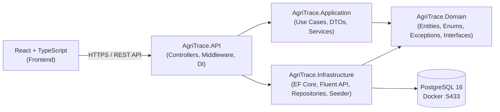

<div align="center">

# 🌾 AgriTrace OCOP

### Hệ thống Kinh doanh Nông sản & Đặc sản Vùng miền Chuẩn OCOP 3 Miền (63 Tỉnh thành)
*Tích hợp Truy xuất Nguồn gốc Minh bạch bằng Mã QR — Kiểm soát Thời gian Cách ly (PHI) & Khóa Bất biến Lô Thu hoạch*

[](https://dotnet.microsoft.com/)
[](https://www.postgresql.org/)
[](https://learn.microsoft.com/ef/core/)
[](https://react.dev/)
[](#kiểm-thử)
[](https://www.docker.com/)

</div>

---

## 🎯 Tổng quan Đề tài

**AgriTrace OCOP** (phiên bản mở rộng từ đề tài *ĐT08 – AgriTrace*) là nền tảng thương mại điện tử chuyên biệt cho nông sản và đặc sản vùng miền chuẩn OCOP trên khắp **3 miền — 63 tỉnh/thành phố Việt Nam**, kết hợp cơ chế **truy xuất nguồn gốc chống giả mạo**.

### Điểm nhấn Kỹ thuật & Nghiệp vụ
| Trụ cột | Cơ chế triển khai thực tế |
|---|---|
| **Truy xuất Nguồn gốc (Core Domain)** | Ghi nhật ký canh tác (`FarmingLog`) kèm thời gian cách ly an toàn (**PHI**); tự động chặn thu hoạch sớm còn dư lượng thuốc BVTV; khóa bất biến lô thu hoạch (`IsLocked = true`) kèm chữ ký **HMAC-SHA256**. |
| **Đa Chứng nhận & Dinh dưỡng** | Quan hệ **1–N** (`AgriProduct` → `ProductCertification`) hỗ trợ đồng thời `OCOP`, `VietGAP`, `GlobalGAP`, `Organic`, `VSATTP`, `HACCP`; chỉ số dinh dưỡng lưu dạng **`jsonb`** linh hoạt trên PostgreSQL. |
| **An toàn Giao dịch & Chống Race Condition** | Tận dụng cột hệ thống **`xmin`** của PostgreSQL làm Optimistic Concurrency Token chống bán âm kho; **`IdempotencyKey`** (Unique) chống đặt trùng đơn; giữ kho thanh toán **15 phút** + hoàn kho tự động; Transaction nguyên tử qua **`IUnitOfWork`**. |
| **Phân quyền 4 Vai trò (RBAC)** | `Buyer` (Người mua) • `Cooperative` (Hợp tác xã) • `Moderator` (Kiểm duyệt viên) • `Admin` (Quản trị viên). |

---

## 🏗️ Kiến trúc Hệ thống (Clean Architecture)



---

## 📂 Cấu trúc Thư mục

```text
agritrace-ocop/
├── .github/workflows/ci.yml                 # GitHub Actions CI tự động build & test
├── backend/
│   ├── AgriTrace.sln
│   ├── docker-compose.yml                   # PostgreSQL 16 (container: agritrace-postgres, port 5433)
│   ├── AgriTrace.Domain/                    # Tầng lõi (không phụ thuộc hạ tầng)
│   │   ├── Entities/                        # 10 Entities: Region, Province, Cooperative, AgriProduct,
│   │   │                                    # ProductCertification, HarvestBatch, FarmingLog,
│   │   │                                    # Order, OrderItem, ViolationReport
│   │   ├── Enums/                           # 5 Enums nghiệp vụ
│   │   ├── Exceptions/                      # BusinessRuleException (400), NotFoundException (404), ConflictException (409)
│   │   └── Interfaces/                      # IUnitOfWork & 6 Repository Interfaces
│   ├── AgriTrace.Application/               # Tầng ứng dụng (Use Cases / Services / DTOs)
│   ├── AgriTrace.Infrastructure/            # Tầng hạ tầng
│   │   ├── DependencyInjection.cs           # Đăng ký DbContext, UnitOfWork & 6 Repositories
│   │   └── Persistence/
│   │       ├── AgriTraceDbContext.cs        # 10 DbSet, cấu hình jsonb & xmin concurrency token
│   │       ├── AgriTraceDbSeeder.cs         # Seed 3 Miền, 63 Tỉnh, 9 HTX, 18 đặc sản OCOP, 2 lô QR
│   │       ├── Configurations/              # 10 class Fluent API (FK, Index lọc, Unique Index)
│   │       ├── Migrations/                  # EF Core Migration Init
│   │       └── Repositories/                # EfUnitOfWork & 6 EfRepository
│   ├── AgriTrace.API/                       # ASP.NET Core Web API Entry Point
│   └── AgriTrace.Tests/                     # xUnit Tests (12 Domain + 5 SQLite Integration = 17/17 Passed)
└── frontend/                                # React + TypeScript + Vite
```

---

## 🗺️ Lộ trình Phát triển (Git Workflow)

- [x] **`feat/project-skeleton`** — Khởi tạo Clean Architecture 4 lớp, Frontend React+Vite, Docker Compose & GitHub Actions CI.
- [x] **`chore/setup-skills-spec`** — Thiết lập tài liệu đặc tả & quy chuẩn giao diện.
- [x] **`feat/domain-model`** — 10 Entities, 5 Enums, 3 Domain Exceptions, `IUnitOfWork`, 6 Repository Interfaces & **12/12 Domain Unit Tests**.
- [x] **`feat/database-efcore`** — PostgreSQL 16 + EF Core + Dapper, Fluent API (`jsonb`, `xmin`, Unique Index `BatchCode` & `IdempotencyKey`), Migration `Init`, `SeedAsync` (3 Miền, 63 Tỉnh, 9 HTX, 18 đặc sản OCOP, 2 lô QR), `EfUnitOfWork`, 6 `EfRepository` & **5/5 SQLite In-Memory Integration Tests**.
- [ ] **`feat/auth-security`** — ASP.NET Core Identity, Argon2id, JWT Access/Refresh Token & phân quyền 4 vai trò.
- [ ] **`feat/catalog-traceability-api`** — API Danh mục đặc sản, Lọc đa tiêu chí, Nhật ký canh tác & Truy xuất QR HMAC-SHA256.
- [ ] **`feat/orders-moderation-reports`** — API Đặt hàng (giữ kho 15 phút, chống Race Condition), Kiểm duyệt & Báo cáo vi phạm.
- [ ] **`feat/frontend-react`** — Giao diện người dùng React + TypeScript.
- [ ] **`chore/testing-docker-deploy`** — Kiểm thử tổng thể, Dockerization & Triển khai.

---

## 🚀 Hướng dẫn Chạy Cục bộ

### 1. Yêu cầu môi trường
- [.NET 11 SDK](https://dotnet.microsoft.com/)
- [Node.js v20+](https://nodejs.org/)
- [Docker Desktop](https://www.docker.com/products/docker-desktop/)

### 2. Khởi chạy PostgreSQL 16 (Docker — cổng `5433`)
```bash
docker compose -f backend/docker-compose.yml up -d
```

### 3. Áp dụng Migration & Khởi chạy API (tự động Seed dữ liệu mẫu)
```bash
dotnet ef database update --project backend/AgriTrace.Infrastructure --startup-project backend/AgriTrace.API
dotnet run --project backend/AgriTrace.API
```

### 4. Kiểm thử
```bash
dotnet test backend/AgriTrace.sln
```
> Kết quả hiện tại: **`Passed: 17, Failed: 0`** *(12 Domain Unit Tests + 5 SQLite In-Memory Repository Integration Tests)*.
